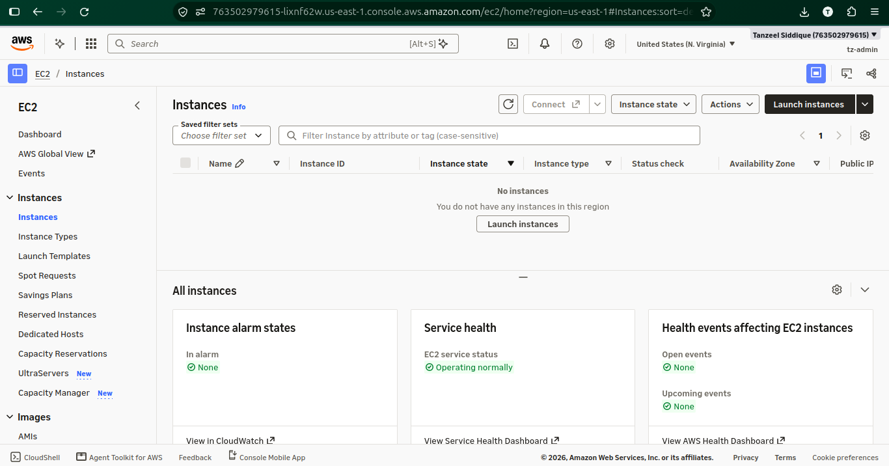
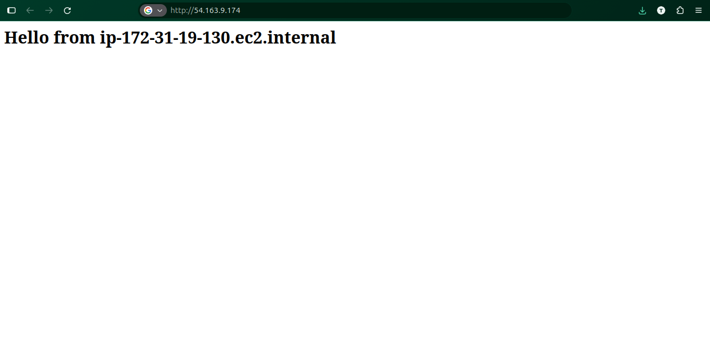

# Stage 3 — Week 1: AWS Account Security, CLI, Pricing & EC2 Web Server

## Overview
This week focused on setting up a secure AWS environment in `us-east-1` (N. Virginia), configuring programmatic access via AWS CLI v2, estimating monthly cloud architecture costs, and launching hardened Amazon Linux 2023 EC2 instances serving web pages via Nginx (both manually over SSH and automatically via EC2 User Data).

## Key Tasks Completed
- **Account Hardening & Cost Guardrails:** Enabled MFA on the root account, configured an 80% monthly spend alert (`tz-monthly-10usd`) filtering out credits to track gross spend, created an IAM administrator user (`tz-admin`) with MFA, and set up the friendly sign-in alias (`tz-cloud-lab`).
- **AWS CLI v2 Setup:** Installed AWS CLI v2 on Ubuntu, generated programmatic access keys for `tz-admin`, and verified authentication using `aws sts get-caller-identity`.
- **Cost Modeling:** Built a baseline 24/7 workload estimate (`t3.micro` EC2 + 5 GB S3 Standard + `db.t3.micro` Single-AZ RDS MySQL) using the AWS Pricing Calculator.
  - **Pricing Calculator Estimate:** [View Workload Estimate](https://calculator.aws/#/estimate?id=8381d033ab357eec586054a7843341ec05f79e8d)
- **Manual EC2 & Nginx Deployment (`tz-web-1`):** Launched `tz-web-1` (Amazon Linux 2023, `t3.micro`) with a custom security group (`tz-web-sg` restricting SSH port 22 and opening HTTP port 80), secured the `.pem` private key (`chmod 400`), installed Nginx over SSH, served a custom HTML page, and verified `200` responses in `/var/log/nginx/access.log`.
- **Automated First-Boot Bootstrap (`tz-web-2`):** Launched a second instance (`tz-web-2`) using an **EC2 User Data** shell script to automatically install Nginx and display the server's internal hostname (`hostname -f`) on port 80 without manual SSH configuration, ran the Stop-vs-Start public IP experiment, and terminated all resources post-lab.

## Key Takeaways & Troubleshooting Notes
- **ISP CGNAT & SSH Rules:** Dynamic ISP routing (CGNAT) can cause outbound SSH traffic to exit from a different IP than what the browser reports for "My IP". Adjusting the security group inbound rule resolved the port 22 timeout immediately.
- **HTTP vs. HTTPS:** Serving on port 80 works over `http://` when Nginx and the security group allow port 80, whereas `https://` requires TLS configuration and an inbound rule on port 443.
- **Stop vs. Start Public IP Behavior:** Stopping and restarting an EC2 instance releases its ephemeral Public IPv4 address and assigns a brand-new Public IPv4 address, whereas its Private IPv4 address and EBS volume data persist.
- **Terminate vs. Stop Billing:** Stopping an EC2 instance halts compute billing, but AWS continues charging for attached EBS storage and allocated IPv4 addresses until the instance is **Terminated**.

## Evidence & Verification
- [Detailed Cloud Fundamentals & EC2 Vocabulary Notes](./notes.md)

### 1. IAM User & Account Configuration

### 2. Daily Administrator User (`tz-admin`)

### 3. Multi-Factor Authentication (MFA) Enabled

### 4. Monthly Budget & Spend Alert (`tz-monthly-10usd`)

### 5. AWS CLI Authentication (`aws sts get-caller-identity`)

### 6. EC2 Instance Running (`tz-web-1`)

### 7. Custom Nginx Web Page Output

### 8. Post-Lab Cleanup & Resource Termination

### 9. Automated User Data Bootstrap Output (`tz-web-2`)

